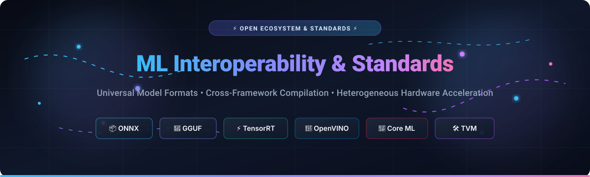
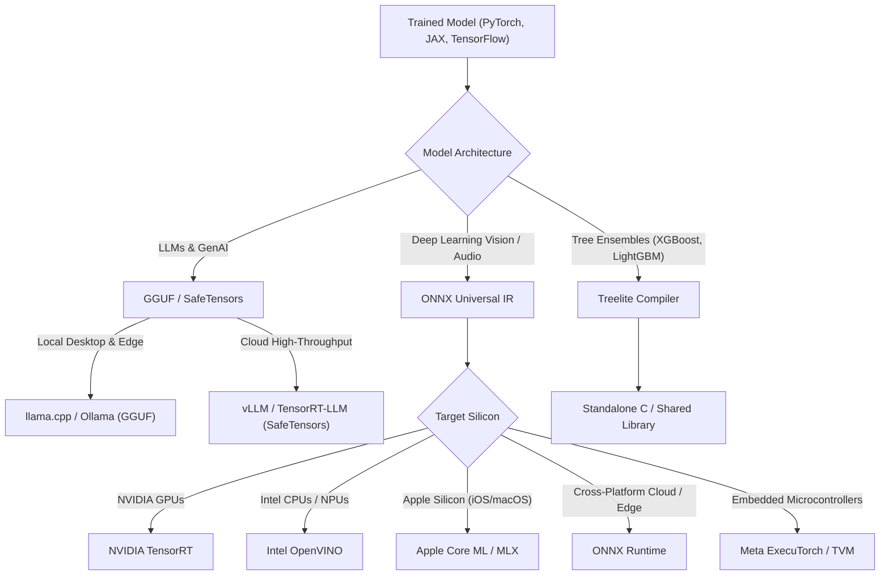

  

# Awesome ML Interoperability & Standards 🚀

  
  
  
  
  
  
  

---

## 🌟 Top ML Interoperability & Standards Tools Ecosystem

> **A rigorously curated directory of SaaS Platforms, Open Standards, Cross-Framework Converters, and Hardware-Targeted Compilation Engines.**  
> *Enabling models trained in PyTorch, JAX, or TensorFlow to execute seamlessly across Intel CPUs, NVIDIA GPUs, Apple Neural Engines, AMD ROCm, and Edge NPUs.*  
> **Last updated: March 2026**

Machine learning interoperability standards define how computational graphs and trained weights are serialized, converted, quantized, and executed across heterogeneous hardware and disparate training frameworks. Without portable standards like **ONNX**, **GGUF**, and **SafeTensors**, machine learning engineering teams face vendor lock-in, duplicate engineering workflows, and severe runtime friction when deploying production models to cloud and edge devices.

---

## 📑 Table of Contents

- [🌐 Sector Overview & Market Dynamics](#-sector-overview--market-dynamics)
- [☁️ SaaS & Hosted Platforms](#️-saas--hosted-platforms)
- [💻 Open-Source Projects & Frameworks](#-open-source-projects--frameworks)
- [🎯 Architecture & Decision Flow](#-architecture--decision-flow)
- [🤝 How to Contribute](#-how-to-contribute)
- [📈 Star History](#-star-history)
- [💖 Support & Community](#-support--community)
- [⚖️ Disclaimer](#️-disclaimer)

---

## 🌐 Sector Overview & Market Dynamics

The global Machine Learning Model Optimization and Interoperability market is valued at **$3.8 Billion in 2025** and is projected to expand to **$18.4 Billion by 2032**, registering a robust Compound Annual Growth Rate (**CAGR of 25.2%**). Growth is propelled by accelerating enterprise AI inference costs, escalating heterogeneous compute diversity (GPUs, TPUs, custom ASICs, and mobile NPUs), and cross-cloud sovereignty requirements.

The sector demonstrates **moderate-to-high concentration at the hardware runtime layer**—where semiconductor leaders (such as NVIDIA with TensorRT and Intel with OpenVINO) maintain proprietary walled gardens optimized for silicon-specific performance. Conversely, the market remains **moderately fragmented at the compilation and format exchange layer**, where universal open standards (ONNX, GGUF, SafeTensors) and hardware-agnostic compiler backends (Apache TVM, OpenXLA, Modular MAX) counterbalance vendor lock-in, fostering a dynamic multi-framework ecosystem.

---

## ☁️ SaaS & Hosted Platforms

The following hosted solutions provide automated model compilation, hardware benchmarking, cross-framework conversion pipelines, and low-latency inference runtimes.

| Platform / Tool | Description & Target Hardware | Starting Pricing | Free Tier / Trial Limits | Company Scale (Valuation / Revenue) |
| :--- | :--- | :--- | :--- | :--- |
| **[Apple Core ML Cloud & Tools](https://developer.apple.com/machine-learning/)** | 🍏 On-device ML compilation, weight compression, and acceleration optimized for Apple Silicon (Neural Engine, M-Series, A-Series chips). | **$99.00/year** (Apple Developer Program membership required for commercial distribution) | **100% Free** local conversion & execution via Xcode and Core ML Tools; free sandbox testing for up to 10,000 TestFlight external testers. | **~$3.4 Trillion Market Cap** ($383 Billion annual revenue) |
| **[Deci AI (NVIDIA)](https://deci.ai/)** | ⚡ Automated Neural Architecture Search (AutoNAC), hardware-aware model compilation, and ultra-low latency inference optimization across x86 CPUs and NVIDIA GPUs. | **$400.00/month** (Deci Infer Developer starting subscription tier) | **14-day free trial** including 50 automated model compilation benchmark runs and 5 production hardware target exports. | **~$3.1 Trillion Market Cap** (Parent: NVIDIA; acquired Deci AI for $165 Million) |
| **[OctoAI (NVIDIA)](https://octo.ai/)** | 🐙 Multi-hardware model acceleration platform based on Apache TVM, automatically tuning models across AWS, GCP, AMD, and NVIDIA silicon. | **$20.00/month** base subscription fee + **$0.15/GPU-hour** for active compute instances | **$10.00 in free compute credits** credited automatically upon account registration with no expiration date. | **~$3.1 Trillion Market Cap** (Parent: NVIDIA; acquired OctoAI for $165 Million) |
| **[Hugging Face Endpoints](https://huggingface.co/inference-endpoints)** | 🤗 Managed containerized inference and hardware-accelerated serving pipelines powered by Hugging Face Optimum, ONNX Runtime, and TensorRT. | **$9.00/user/month** (Hugging Face Pro Plan) or **$0.06/hour** for serverless CPU/GPU inference instances | **Free forever tier** with 30,000 serverless inference API calls/month, unlimited public model repositories, and up to 50 GB storage. | **$4.5 Billion Valuation** ($235 Million Series D backed by Google, Amazon, and NVIDIA) |
| **[Modular MAX Platform](https://www.modular.com/max)** | 🔮 Unified AI execution engine powered by the Mojo language compiler, serving PyTorch and ONNX models across diverse CPU/GPU architectures without rewriting code. | **$15.00/user/month** (Modular Team subscription) or **$0.000045/token** on MAX Cloud serving infrastructure | **Free Developer Edition** with unlimited local CPU and GPU execution, complete access to Mojo compiler & standard library, and community forum support. | **$600 Million Valuation** ($130 Million venture funding led by General Catalyst and GV) |
| **[Edge Impulse](https://www.edgeimpulse.com/)** | 📟 End-to-end embedded and edge ML development platform, cross-compiling models to ARM Cortex, ESP32, Apple Silicon, and edge microcontrollers. | **$1,250.00/month** (Edge Impulse Enterprise starting package) | **Free Developer Plan** including 4 cloud computing hours/month, 20-minute maximum job runtime limit, and 100 enterprise ML export blocks. | **$300 Million Valuation** ($54 Million Series B led by Coatue and Canvas Ventures) |
| **[Baseten](https://www.baseten.co/)** | 🚢 High-performance model deployment infrastructure featuring Truss open-source packaging, cold-start optimization, and automated TensorRT-LLM compilation. | **$0.0003/second** (~$1.08/GPU-hour for dedicated NVIDIA A10G instances) | **$30.00 in free compute credits** granted upon registration, valid for 30 days of active sandbox deployment. | **$220 Million Valuation** ($40 Million Series B led by IVP and Spark Capital) |

---

## 💻 Open-Source Projects & Frameworks

*Ranked strictly in descending order by GitHub community Stars_Counts.*

### 1. [llama.cpp (GGUF Format)](https://github.com/ggml-org/llama.cpp) 
- **Description**: The definitive C/C++ cross-platform inference engine for large language models, creator of the ubiquitous **GGUF (GPT-Generated Unified Format)**. GGUF is the undisputed open standard for distributing quantized LLM weights across macOS Metal, CUDA, ROCm, Vulkan, SYCL, and plain CPUs without external Python runtime dependencies.
- **Interoperability Role**: Standardized unified file format encapsulating tensor weights, tokenizers, quantization metadata, and hyperparameter definitions in a single portable binary.
- **License**: MIT

### 2. [PyTorch TorchScript](https://github.com/pytorch/pytorch) 
- **Description**: PyTorch's intermediate representation and JIT compiler suite. TorchScript extracts the computational graph and learned parameters from dynamic Python code into an optimized, serialized artifact (`.pt`) executable in standalone C++ environments (LibTorch) with zero Python dependencies.
- **Interoperability Role**: Bridges research prototypes written in imperative Python directly into production C++ low-latency serving stacks.
- **License**: BSD-3-Clause

### 3. [MLX](https://github.com/ml-explore/mlx) 
- **Description**: Apple Silicon's native array framework and compiler for machine learning research. Features an API designed to closely mirror NumPy and PyTorch while running operations directly across the unified memory architecture of Apple M-Series GPUs and CPUs with zero memory copy overhead.
- **Interoperability Role**: Seamless conversion pathways for Hugging Face transformer models into Apple Silicon-native computation graphs.
- **License**: MIT

### 4. [ONNX Runtime](https://github.com/microsoft/onnxruntime) 
- **Description**: Microsoft's high-performance cross-platform scoring engine for ONNX models. Provides a unified execution API with pluggable Execution Providers (EPs) for NVIDIA CUDA/TensorRT, Intel OpenVINO, DirectML, Apple Core ML, Qualcomm QNN, and WebAssembly.
- **Interoperability Role**: Decouples hardware acceleration targets from application code; one ONNX model runs across any silicon provider through appropriate execution providers.
- **License**: MIT

### 5. [ONNX (Open Neural Network Exchange)](https://github.com/onnx/onnx) 
- **Description**: The universal intermediate representation (IR) standard governed by the Linux Foundation AI & Data. Defines an extensible computation graph schema, standard operator sets (opsets), and protobuf-based serialization that allows models to transition seamlessly between PyTorch, TensorFlow, MXNet, Scikit-Learn, and JAX.
- **Interoperability Role**: Serves as the central intermediary pivot in modern compilation pipelines: `Framework -> ONNX -> Hardware Optimizer`.
- **License**: Apache-2.0

### 6. [OpenAI Triton](https://github.com/triton-lang/triton) 
- **Description**: An open-source language and compiler for writing highly efficient custom GPU kernels with Python-like syntax. Enables ML practitioners to write peak-performance kernels matching or outperforming hand-written CUDA without deep microarchitecture expertise.
- **Interoperability Role**: Cross-hardware GPU kernel synthesis targeting NVIDIA CUDA, AMD ROCm, and emerging Intel GPU backends.
- **License**: MIT

### 7. [Apache TVM](https://github.com/apache/tvm) 
- **Description**: An end-to-end deep learning compiler stack for CPUs, GPUs, and specialized hardware accelerators. Ingests models from PyTorch, TensorFlow, ONNX, and Keras, then automatically compiles them into bare-metal optimized machine code via automated tensor scheduling and Relax/TensorIR abstractions.
- **Interoperability Role**: Full hardware-agnostic compilation pipeline eliminating proprietary runtime dependencies for embedded, edge, and cloud hardware.
- **License**: Apache-2.0

### 8. [NVIDIA TensorRT](https://github.com/NVIDIA/TensorRT) 
- **Description**: NVIDIA's premier inference optimizer and runtime for high-throughput, low-latency deep learning. Performs graph fusion, kernel autotuning, dynamic tensor memory management, and mixed-precision quantization (FP16, BF16, INT8, FP8) on NVIDIA GPUs.
- **Interoperability Role**: Ingests ONNX computation graphs and builds serialized, hardware-locked binary execution engines (`.engine` / `.plan`).
- **License**: Apache-2.0

### 9. [OpenVINO](https://github.com/openvinotoolkit/openvino) 
- **Description**: Intel's open-source toolkit for optimizing and deploying deep learning inference across Intel CPUs (x86 and ARM), integrated GPUs, discrete GPUs, and Vision Processing Units (NPUs). Converts ONNX, TensorFlow, PaddlePaddle, and PyTorch models to OpenVINO Intermediate Representation (`.xml` + `.bin`).
- **Interoperability Role**: Premier deployment standard for heterogeneous Intel x86 client and server architectures with built-in INT8 quantization (NNCF).
- **License**: Apache-2.0

### 10. [Apple Core ML Tools](https://github.com/apple/coremltools) 
- **Description**: Apple's open-source Python package for converting models from PyTorch, TensorFlow, and ONNX into the native `.mlpackage` format consumed by Apple Core ML. Includes advanced quantization, pruning, and palettization pipelines for on-device Apple Neural Engine (ANE) acceleration.
- **Interoperability Role**: Official converter connecting the open ML training ecosystem to iOS, iPadOS, macOS, watchOS, and visionOS runtimes.
- **License**: BSD-3-Clause

### 11. [ExecuTorch](https://github.com/pytorch/executorch) 
- **Description**: Meta's next-generation end-to-end edge deployment runtime for PyTorch models. Successor to PyTorch Mobile, featuring a lightweight, hermetic C++ runtime with pluggable delegate backends (Apple MPS, ARM Ethos-U, Qualcomm QNN, Vulkan) and zero-overhead memory planning.
- **Interoperability Role**: Native on-device representation enabling PyTorch 2.x `torch.export` graphs to execute efficiently on wearables, mobile phones, and embedded microcontrollers.
- **License**: BSD-3-Clause

### 12. [OpenXLA](https://github.com/openxla/xla) 
- **Description**: An open-source machine learning compiler ecosystem backed by Google, AMD, Arm, Intel, and NVIDIA. Compiles computation graphs from JAX, PyTorch, and TensorFlow into optimized machine instructions for GPUs, CPUs, and Google TPUs.
- **Interoperability Role**: Provides StableHLO (High-Level Optimizer), an interoperability standard between ML frameworks and silicon code generators.
- **License**: Apache-2.0

### 13. [SafeTensors](https://github.com/huggingface/safetensors) 
- **Description**: Hugging Face's lightweight, secure binary storage format for deep learning weights. Created as a modern replacement for Python's vulnerable `pickle` serialization format, featuring zero-copy memory mapping (`mmap`) and deterministic header layouts.
- **Interoperability Role**: Universal cross-framework tensor serialization standard adopted across PyTorch, TensorFlow, Flax/JAX, and Rust backends.
- **License**: Apache-2.0

### 14. [Hugging Face Optimum](https://github.com/huggingface/optimum) 
- **Description**: An extension of the Hugging Face Transformers library that accelerates model export and inference targeting specific hardware platforms. Provides native integration with ONNX Runtime, Intel OpenVINO, NVIDIA TensorRT-LLM, and AWS Neuron.
- **Interoperability Role**: Provides single-line Python APIs (`ORTModelForSequenceClassification`, `OVModelForCausalLM`) to export and run Hugging Face models on target accelerators.
- **License**: Apache-2.0

### 15. [Treelite](https://github.com/dmlc/treelite) 
- **Description**: The specialized universal model compiler for decision tree ensembles. Ingests models trained in XGBoost, LightGBM, CatBoost, and Scikit-Learn, compiling them into standalone C code or optimized shared libraries.
- **Interoperability Role**: Eliminates heavyweight Python and JVM runtime overhead for classical tabular ML models deployed into latency-critical production environments.
- **License**: Apache-2.0

### 16. [NNEF Tools](https://github.com/KhronosGroup/NNEF-Tools) 
- **Description**: The Khronos Group's Neural Network Exchange Format (NNEF) parser and conversion toolset. An open, royalty-free standard designed to facilitate reliable deployment of neural networks onto edge microcontrollers, automotive platforms, and embedded DSPs.
- **Interoperability Role**: Provides standardized interchange between training frameworks and embedded hardware targets including OpenVX and Android NNAPI.
- **License**: Apache-2.0

---

## 🎯 Architecture & Decision Flow

When designing a production ML deployment pipeline across diverse infrastructure, use this recommended selection pathway:

---

## 🤝 How to Contribute

We welcome contributions from engineers, researchers, and open-source maintainers! To contribute:

1. 🍴 **Fork the repository** on GitHub.
2. 🌿 **Create a feature branch** (`git checkout -b feature/add-interop-tool`).
3. 📝 **Add your tool** following the existing format:
   - For SaaS: Include specific starting tier prices, specific free tier limits, and company scale valuation.
   - For Open-Source: Include official shields.io Stars_Badge linking to the `/stargazers` page, description, interoperability role, and license.
4. 🧪 **Verify all links and markdown formatting**.
5. 🚀 **Submit a Pull Request** with a descriptive summary of your additions.

---

## 📈 Star History

---

## 💖 Support & Community

Thank you for exploring the **Awesome ML Interoperability & Standards** ecosystem! If this curated guide helped you streamline your cross-framework conversion pipelines or select the optimal inference runtime:

- ⭐ **Star this repository** to support our open-source indexing work!
- 🍴 **Fork and share** with your machine learning engineering team and community.
- 💬 **Join our discussions** on [Discord](https://discord.gg/jc4xtF58Ve) to discuss model compression, quantization, and runtime benchmarks.
- ☕ **Buy us a coffee or sponsor maintenance** via the [GitHub Sponsor Dashboard](https://github.com/sponsors/ishandutta2007).

---

## ⚖️ Disclaimer

- This repository is a community-curated, independent directory and does not constitute formal endorsement of any specific commercial platform or software vendor.
- Interoperability guarantees vary by operator coverage, opset versions, and precision format support. Always validate numerical parity between original framework outputs and compiled target execution engines using validation holdout datasets before rolling into mission-critical production.

---

  <b>Built with ❤️ for ML Engineers, MLOps Practitioners, and Hardware Optimization Specialists worldwide.</b>

